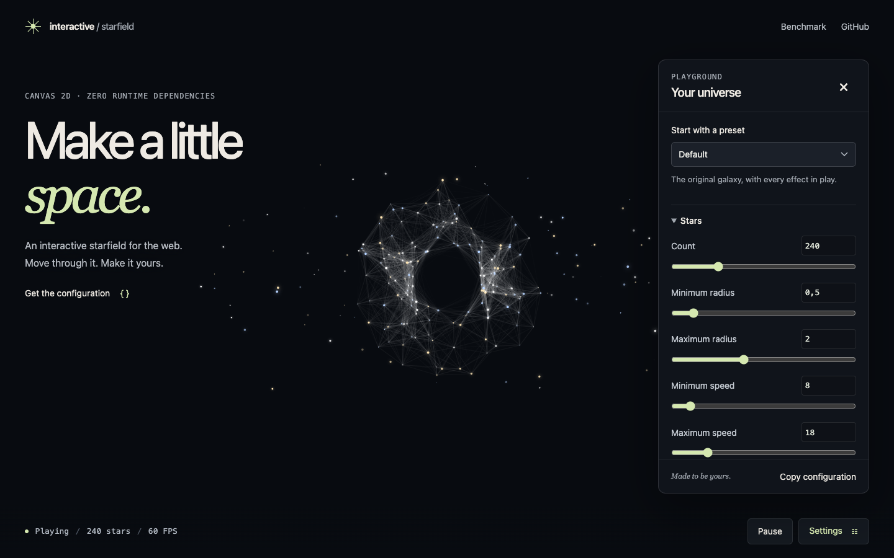

# interactive-starfield

[](LICENSE)

A lightweight, dependency-free JavaScript library for interactive Canvas 2D
starfield backgrounds. Framework-agnostic, configurable, and based on the
preserved [original prototype](prototype/starfield.js).



**Development status:** source usage and the local playground work today. The npm
package and public demo have not been published; the package is marked private.
The API is still under development. GitHub Pages deployment is planned separately.
CI and a manual Pages workflow are prepared; their first hosted runs are pending.
See [CI and deployment](docs/DEPLOYMENT.md) for the rollout steps.

[Quick start](#quick-start) · [Configuration](#configuration) · [Presets](#presets) ·
[API details](docs/API.md) · [Performance](docs/PERFORMANCE.md) ·
[Contributing](CONTRIBUTING.md)

## Features

- Stars with twinkle, depth-based motion, parallax, repulsion, glow, local
  connections, and shooting-star trails.
- Four presets, partial configuration, and runtime updates.
- Multiple independent instances, CSS-based sizing, and high-DPI rendering.
- Start/stop/destroy lifecycle, visibility suspension, and reduced-motion support.
- Zero runtime dependencies, ESM/UMD builds, and TypeScript declarations.
- An interactive playground and a separate measurement page.

## Run the playground

With repository access, clone and install the development dependencies:

```sh
git clone https://github.com/Jaason/interactive-starfield.git
cd interactive-starfield
npm ci
npm run dev
```

Open Vite's printed URL. For the full development and test toolchain, use Node
22.12+ in the 22.x line, Node 24.x, or Node 26+ (verified with 26.2.0). The package
and Vite engine ranges also admit Node 20.19+, but the installed Vitest 5 does
not. These are tooling requirements; the library has no Node runtime dependency.

The playground offers live settings, presets, pause/reset, configuration copying,
and a link to the benchmark. It starts with Default and respects reduced motion.
Reload manually after edits; HMR is disabled to avoid retaining old instances.
[Playground behavior and controls](docs/PLAYGROUND.md).

There is no public live-demo URL or registry installation yet. Source imports are
shown below; the prepared package can also be installed from a local tarball.

## Install the local package

From this checkout, create the distribution archive (the `prepack` hook rebuilds
the library automatically):

```sh
npm pack
```

In another project, install the resulting file using its actual path:

```sh
npm install /path/to/interactive-starfield/interactive-starfield-0.0.0.tgz
```

Then use `import { Starfield } from 'interactive-starfield'` in JavaScript or
TypeScript. Mount and size the canvas as shown in the quick start below. No build
step runs when installing this tarball, and the package has no runtime dependencies.
`0.0.0` is a local development version, not an npm release.

For a classic browser script, copy `dist-lib/starfield.umd.cjs` from the installed
package to your site's public assets as `starfield.umd.js`, load it with a normal
`<script src="/assets/starfield.umd.js"></script>`, and construct
`new InteractiveStarfield.Starfield('#starfield')` after the canvas is mounted.
Serve the file with a JavaScript MIME type. CommonJS consumers can use
`const { Starfield } = require('interactive-starfield')`.

The tarball includes only the builds, declarations, README, changelog, license,
and package metadata. Linked guides, source examples, and screenshots live in the
[repository](https://github.com/Jaason/interactive-starfield), which is still private.
See [package preparation and verification](docs/PACKAGING.md) for formats, sizes,
external-project tests, and release limitations.

## Quick start

Mount a canvas with positive CSS dimensions independent of its backing attributes,
then import the named `Starfield` export. In the provided `docs/examples/` directory:

<!-- example: quick-start -->
```js
import { Starfield } from '../../src/index.js';

const field = new Starfield('#starfield', {
  preset: 'deep-space',
  stars: { count: 140 },
  rendering: { maxDpr: 2 },
});

// When removing this background:
// field.destroy();
```

The [complete HTML example](docs/examples/quick-start.html) includes canvas sizing,
accessible HTML content, and page cleanup/restoration. To run it from this checkout:

```sh
npm exec -- vite .
```

Open `/docs/examples/quick-start.html` under the printed local URL. Use HTTP,
not `file://`. Adapt `../../src/index.js` to the source location in your own app;
after installing the local tarball, replace it with `interactive-starfield`.

Use one instance per canvas. Do not reinitialize the same canvas before calling
`destroy()` on the previous instance. The library leaves canvas DOM/CSS ownership
to the host; source imports alone do not access browser globals or start animation.

## Configuration

Options are partial, two-level objects. Omitted/undefined fields use defaults in
the constructor and retain current values during ordinary updates. Arrays replace
by copy. Defaults and resolved configuration are frozen; caller objects are not
retained. Unknown keys, invalid types, non-finite numbers, invalid ranges, and null
sections throw descriptive errors. Validation applies even to disabled effects.

All resolved settings and defaults are listed below. `preset` is an optional input
selector (see the next section), not a property retained in `field.config`.

| Option | Default | Meaning / valid values |
| --- | --- | --- |
| `rendering.maxDpr` | `null` | Native DPR when null; otherwise a finite cap > 0. Lower values trade sharpness for fewer pixels. |
| `accessibility.respectReducedMotion` | `true` | Boolean. Respect the system preference with a static scene. |
| `stars.count` | `240` | Nonnegative safe integer. Zero does not disable shooting stars. |
| `stars.minRadius` | `0.5` | Minimum star radius in CSS pixels; >= 0 and <= maxRadius. |
| `stars.maxRadius` | `2` | Maximum star radius in CSS pixels; > 0 and >= minRadius. |
| `stars.minSpeed` | `8` | Minimum base speed in CSS pixels/second, before depth scaling; >= 0 and <= maxSpeed. |
| `stars.maxSpeed` | `18` | Maximum base speed in CSS pixels/second, before depth scaling; >= minSpeed. |
| `stars.colors` | `["255, 255, 255", "180, 210, 255", "255, 230, 180"]` | Nonempty array of RGB triplet strings; each channel 0–255. Replaces the previous array. |
| `twinkle.enabled` | `true` | Boolean. Enable brightness variation. |
| `twinkle.strength` | `0.35` | Brightness variation amplitude; >= 0. Final twinkling opacity is clamped to 0.15–1. |
| `twinkle.speed` | `0.002` | Phase multiplier in radians per active millisecond; >= 0. |
| `parallax.enabled` | `true` | Boolean. Enable pointer parallax. |
| `parallax.strength` | `18` | CSS-pixel scale multiplied by normalized pointer position and star depth; >= 0. |
| `repulsion.enabled` | `true` | Boolean. Enable repulsion near the pointer. |
| `repulsion.radius` | `50` | Interaction radius in CSS pixels; > 0. |
| `repulsion.strength` | `22` | Force scale at the 60 Hz reference step; >= 0. |
| `repulsion.friction` | `0.9` | Offset retention at a 60 Hz reference step; >= 0 and < 1. |
| `shootingStar.minSpeed` | `600` | Minimum shooting-star speed in CSS pixels/second; >= 0 and <= maxSpeed. |
| `shootingStar.maxSpeed` | `900` | Maximum shooting-star speed in CSS pixels/second; >= minSpeed. |
| `shootingStar.lineWidth` | `1` | Trail width in CSS pixels; > 0. |
| `generation.mode` | `"galaxy"` | Initial distribution: "galaxy" or "random". |
| `galaxy.centerStrength` | `2.2` | Radial power exponent; > 0. Larger values concentrate stars toward the center. |
| `galaxy.spread` | `0.48` | Radius scale relative to the smaller canvas dimension; > 0. |
| `galaxy.flattening` | `0.45` | Vertical scale of the initial distribution; > 0. |
| `galaxy.rotation` | `0.8` | Radius-dependent angular coefficient; any finite number. Does not generate spiral arms. |
| `connections.enabled` | `true` | Boolean. Enable connections near the pointer. |
| `connections.radius` | `90` | Maximum pair distance in rendered CSS-pixel coordinates; > 0. |
| `connections.mouseRadius` | `160` | Pointer neighborhood radius in rendered CSS pixels; > 0. |
| `connections.lineOpacity` | `0.22` | Line opacity scale; 0–1 inclusive. |
| `connections.lineWidth` | `0.5` | Line width in CSS pixels; > 0. |
| `glow.enabled` | `true` | Boolean. Enable per-star Canvas shadows. |
| `glow.strength` | `4` | Shadow scale multiplied by star radius and depth; >= 0. |

Colors use strings such as `'180, 210, 255'`, not hex, CSS color names, or
`rgb(...)`. Configuration validation does not enforce a device performance budget.
See [configuration and update details](docs/API.md#configuration) for errors,
copying, timing, and regeneration behavior.

## Presets

| Name | Appearance | Stars | Distribution | Connections |
| --- | --- | --- | --- | --- |
| `default` | Original settings and all effects | 240 | Galaxy | Enabled |
| `deep-space` | Sparse, slow, cool-colored stars | 90 | Random | Disabled |
| `milky-way` | A denser, flatter initial band | 360 | Galaxy | Disabled |
| `constellation` | Local pointer connections, no repulsion | 180 | Random | Enabled |

Names are exact and case-sensitive. Explicit selection resolves **defaults →
preset → overrides in the same call**, discarding all earlier overrides. Reselecting
the same preset also resets earlier edits. An omitted or undefined preset retains
the current configuration during an update. There is no public preset registry or
persistent preset name in `field.config`.

```js
field.updateConfig({ preset: 'constellation', stars: { count: 150 } });
field.updateConfig({ glow: { enabled: false } }); // Keep the current base.
field.updateConfig({ preset: 'default' });       // Restore every default.
```

The galaxy is an initial distribution, not a spiral or stationary simulation;
stars continue to drift and wrap. Connections use rendered star positions.
[Full preset values and switching rules](docs/API.md#presets).

## Public API and lifecycle

| API | Contract |
| --- | --- |
| `new Starfield(canvasOrSelector, options?)` | Requires a mounted, positive-size canvas; requests playback automatically. |
| `field.config` | Deeply frozen resolved settings; null after destruction. |
| `field.start()` | Requests playback without duplicate animation loops; returns the instance. |
| `field.stop()` | Cancels rendering and freezes animation time, preserving the last image; returns the instance. |
| `field.updateConfig(patch?)` | Validates and applies a partial update; returns the instance. |
| `field.destroy()` | Cancels frames, removes listeners/observers, clears the image and releases owned references; returns undefined. |

After destruction, stop/destroy are harmless; start/updateConfig throw. Stop retains
resources needed for resuming; destroy releases them but does not remove the canvas
from the DOM. Empty/value-equivalent updates are no-ops. Star or distribution
changes regenerate stars; effect changes retain particle state. Invalid patches
leave the existing configuration intact. Updates never override a manual pause.

Hidden documents and zero-size canvases suspend requested playback. Returning
resumes only if playback is still requested. Active time stops during suspension;
resume uses zero movement delta and other delayed frames are capped at 50 ms.
Nonzero off-screen canvases are not automatically suspended; stop them from the host.
CSS-size changes regenerate stars, while DPR-only changes preserve the scene.
[Lifecycle, sizing, and pointer details](docs/API.md#lifecycle-and-runtime-configuration).

The [two-instance example](docs/examples/multiple.html) runs
[the lifecycle example](docs/examples/lifecycle.js): independent presets, updates,
pause/resume, a DPR cap, and cleanup. Serve it with the same repository-root Vite
command and open `/docs/examples/multiple.html`.

## TypeScript

The source entry resolves [adjacent declarations](src/index.d.ts). For a mounted
canvas, the [checked TypeScript example](docs/examples/typed.ts) uses:

<!-- example: typed -->
```ts
import { Starfield, type PresetName, type StarfieldOptions } from '../../src/index.js';

export function mountTypedBackground(canvas: HTMLCanvasElement): () => void {
  const preset: PresetName = 'deep-space';
  const options: StarfieldOptions = {
    preset,
    stars: { count: 140, colors: ['180, 210, 255'] },
    rendering: { maxDpr: 2 },
  };
  const field = new Starfield(canvas, options);
  field.updateConfig({ twinkle: { strength: 0.2 } });
  return () => field.destroy();
}
```

`StarfieldOptions` accepts partial sections; `ResolvedStarfieldConfig` is readonly.
Numeric ranges and RGB contents are still validated at runtime. npm type exports
and external package installation checks are pending packaging/publication.

## Accessibility and browser compatibility

- Keep meaningful content in HTML. For decorative canvases, use `aria-hidden="true"`
  and CSS `pointer-events: none`; the library does not change those host attributes.
- Reduced motion is respected by default. The scene is static, with no RAF loop
  or shooting-star trail. Resize/config changes can redraw it. Keep this default
  unless your application deliberately manages motion preferences itself.
- Window mouse/touch-move input maps to each canvas. Avoid padding, borders and CSS
  transforms on the canvas; put presentation on its container. Ending a touch,
  scrolling without new input, or leaving the window does not refresh pointer state.

| Environment | Verification status |
| --- | --- |
| Chrome 158 on macOS | Headless rendering, lifecycle, demo, and 30-minute checks executed |
| Safari / Firefox | Explicitly deferred; no verified support claim yet |
| Physical mobile / physical refresh-rate displays | Outstanding; emulated viewport/touch checks are not a substitute |

The source requires browser ES modules, Canvas 2D, and requestAnimationFrame.
ResizeObserver is optional: window resize and stop/start refresh size without it.
If matchMedia is unavailable, animation continues without system preference handling.
The playground additionally uses native dialog and AbortController support. Minimum
browser versions and a complete compatibility matrix have not been established.

## Performance and known limits

A recorded 30-minute run at 240 stars, all effects, DPR 1, and a 1200×400 canvas
in headless Chrome averaged about 60 FPS and 0.604 ms of instance work. Used JS
heap after forced GC was 3.14 MiB initially and 1.06 MiB finally. No sustained
frame-time or retained-heap increase was observed in that run. These are scoped
measurements, not guarantees for other scenes, GPUs, browsers, or devices.

- Connections remain quadratic among nearby stars; glow and large DPR can be costly.
- Consider lower star counts, smaller connection radii, disabled effects, or an
  explicit `rendering.maxDpr` cap when profiling shows a need. Each affects quality.
- Destroy removed backgrounds. Keep dimensions independent of backing attributes.
- Moving pointer forces are sampled per frame, so trajectories need not match
  exactly across refresh rates. The initial galaxy naturally disperses over time.
- The eight-hour stability test and Safari/Firefox checks are explicitly deferred.
  Physical-device targets and total CPU/GPU memory verification remain outstanding.

[Methods, raw results, memory management, and trade-offs](docs/PERFORMANCE.md).
Historical reports are kept separately in [VERIFICATION.md](docs/VERIFICATION.md).

## Development and contribution

```sh
npm test
npm run typecheck
npm run build
npm run build:benchmark
node scripts/verify-docs.mjs
npm run preview
```

The main build produces `dist/index.html` and `dist/benchmark/index.html` with
relative assets/links, checked locally under `/interactive-starfield/`. The
standalone benchmark build writes `dist-benchmark/`. These are static site builds,
not library distribution builds. No deployment happens when building.

See [CONTRIBUTING.md](CONTRIBUTING.md) for setup, tests, browser prerequisites and
review workflow; [CHANGELOG.md](CHANGELOG.md) for unreleased changes; and
[ROADMAP.md](ROADMAP.md) for pending work. All code and documentation use English.

## License

[MIT](LICENSE) © 2026 Jaason Waszkiewicz.
